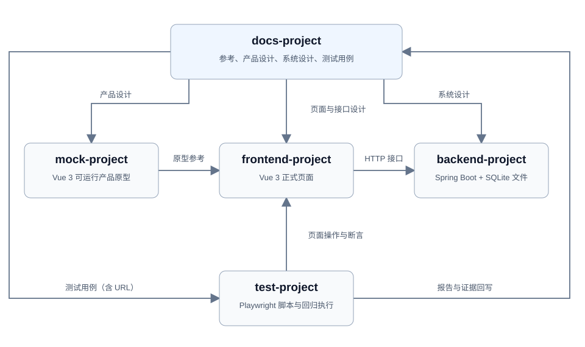

# 完整流程：温度换算

五项目均生成在 `output/` 下：`docs-project/`、`mock-project/`、`frontend-project/`、`backend-project/`、`test-project/`；父级工作约定生成到 `output/AGENTS.md`。

参考 [W3Schools 温度换算网页](https://www.w3schools.com/howto/howto_js_temperature_converter.asp)，只取“华氏输入 → 摄氏结果”一个独立功能。

五项目为文档、Mock、前端、后端、测试；初始化时各自建立 AGENTS。Mock/前端使用 Vue 3，后端使用 Spring Boot。SQLite 只是后端项目内的数据库文件，其用途、位置和表结构由系统设计生成，后端阶段再依据设计实施。

`output/docs-project/` 直接作为知识库根目录，不增加中间层。根目录保留 README、AGENTS 和 00_索引.md；阶段目录用结构化 Markdown 保存输入与产物，附件归阶段 assets/；不保存用户原话。每次开始工作先读 AGENTS、索引和相关设计。

文档项目提供设计与测试依据；Mock 为正式前端提供原型参考；正式前端调用后端接口；测试项目通过 Playwright 操作正式页面，并将报告和证据回写文档项目。SQLite 文件属于后端项目。

按顺序复制下列输入，每阶段完成后再执行下一阶段：

| 阶段                                     | 独立 prompt                                    |
| -------------------------------------- | -------------------------------------------- |
| 0 初始化五项目及 AGENTS                       | [初始化输入](prompts/04_完整案例_00_初始化项目与AGENTS.md)  |
| 1 用website-feature-capture SKILL 采集并存档 | [参考采集输入](prompts/05_完整案例_01_参考采集.md)         |
| 2 产品设计与 Vue 3 Mock                     | [产品与原型输入](prompts/06_完整案例_02_产品设计与Mock.md)   |
| 3 根据参考、结构和目标做系统设计                      | [系统设计输入](prompts/07_完整案例_03_系统设计.md)         |
| 4 测试设计                                 | [测试设计输入](prompts/08_完整案例_04_测试设计.md)         |
| 5 Vue 3 前端实现及本地部署                      | [前端输入](prompts/09_完整案例_05_前端实现与部署.md)        |
| 6 按系统设计实现 Spring Boot + SQLite         | [后端输入](prompts/10_完整案例_06_后端实现与部署.md)        |
| 7 用 UI 测试 SKILL 执行 Playwright 验收       | [UI 验收输入](prompts/11_完整案例_07_UI测试SKILL验收.md) |

参考截图证明观察过什么；设计定义要实现什么；代码和实际测试证明做到什么。这里提供的是带教输入，所有产物都由现场执行生成。
